# 🎮 Awesome Terminal Utilities & Interactive CLI Games 🕹️

  

      

---

## 🌟 Top Terminal Utilities & Interactive CLI Games Ecosystem 🚀

**Curated Directory of Cloud Platforms, Browser Arcades, Fantasy Consoles & Open-Source Terminal User Interface (TUI) Games** 👾

*Discover roguelikes, ASCII art tools, BSD classics, fantasy consoles, SSH multiplayer arcade servers, typing trainers, and interactive CLI toys.*

**Last updated:** November 2026 📅

Welcome to **Awesome-Terminal-Utilities-Interactive-CLI-Games**! 🕹️ This repository indexes premier **SaaS/Hosted web game platforms** alongside top **open-source CLI/TUI repositories** on GitHub. Whether you are searching for pure ANSI dungeon crawlers, lightning-fast Rust TUI engines, Go-powered Bubble Tea utilities, or instant SSH-hosted multiplayer retro arcades, this directory is built for command-line aficionados, developers, sysadmins, and retro gamers. 🌟 Star if you find this useful! 🌟

---

## 📑 Table of Contents 📖

- [📊 Sector Overview & Market Dynamics](#-sector-overview--market-dynamics)
- [☁️ SaaS & Hosted Gaming Platforms](#️-saas--hosted-gaming-platforms)
- [💻 Open-Source GitHub Projects](#-open-source-github-projects)
- [🤝 How to Contribute](#-how-to-contribute)
- [📈 Star History](#-star-history)
- [⚖️ Disclaimer](#️-disclaimer)

---

## 📊 Sector Overview & Market Dynamics 📈

The web browser gaming, indie micro-game, and developer productivity tooling ecosystem represents an estimated **$15.2 Billion global market** spanning casual web portals, indie game distribution storefronts, and developer-focused command-line interface (CLI/TUI) tooling. 

This sector is **moderately fragmented**: massive public entertainment conglomerates (such as Electronic Arts and Asmodee) capture mass-market casual web audiences, while indie distribution portals (such as itch.io and Newgrounds) and dedicated fantasy consoles (like PICO-8 and TIC-80) enjoy strong, loyal developer communities without a single winner-take-all monopoly.

---

## ☁️ SaaS & Hosted Gaming Platforms 🌐

The following table provides detailed pricing tiers, specific free tier limits, and corporate scale (revenue or valuation estimates), sorted in descending order by organization scale:

| 🏷️ Platform | 🏢 Company Scale (Revenue / Valuation) | 💵 Starting Tier Pricing | 🎁 Free Tier Limits | 📝 Description |
| :--- | :--- | :--- | :--- | :--- |
| **[Pogo](https://pogo.com)** | **~$7.6B Revenue** (Parent: Electronic Arts Inc.) | **$6.99 / month** (Club Pogo annual: $39.99/yr) | Free forever with ad support; access to 50+ free casual games & daily challenges | Long-running online casual gaming portal featuring board games, word puzzles, card classics, and multiplayer club tournaments. |
| **[Board Game Arena](https://boardgamearena.com)** | **~$350M+ Revenue** (Parent: Asmodee Group / Embracer) | **$5.00 / month** (Premium annual: $36.00/yr) | Free forever with unlimited games on hundreds of standard titles; cannot start Premium-exclusive tables | Premier browser-based multiplayer tabletop & board game platform supporting real-time and turn-based play across 700+ licensed titles. |
| **[Play-Asia Cloud](https://play-asia.com)** | **~$50M - $75M Est. Revenue** (Private) | **Pay-per-item** (Digital indie games starting at **$4.99 / item**) | Free forever storefront browsing, game trailers, community forums, and downloadable PC/web demos | Global digital gaming storefront and cloud entertainment portal distributing indie, retro, and imported digital game keys. |
| **[Kongregate](https://kongregate.com)** | **~$25M - $35M Est. Revenue** (Private / MTG) | **Pay-per-item microtransactions** (In-game Kred packs starting at **$5.00 for 50 Kreds**) | Free forever unlimited access to 100,000+ browser games with ad support and basic badge earning | Classic browser gaming platform hosting idle, strategy, tower defense, and retro arcade titles with achievements and leaderboards. |
| **[Itch.io Web Arcade](https://itch.io)** | **~$15M - $25M Est. Revenue** (Private indie marketplace) | **Pay-what-you-want / Paid games starting at $1.00** (Free platform fee for buyers) | Free forever unlimited access to over 500,000 free/web games; 1GB upload limit per game for creators | Indie game marketplace and browser-hosted HTML5/WebAssembly arcade featuring thousands of experimental, roguelike, and retro terminal-style games. |
| **[Arkadium](https://arkadium.com)** | **~$15M - $20M Est. Revenue** (Private) | **$3.99 / month** (Arkadium Advantage annual: $29.99/yr) | Free forever access to full catalog of classic card, word, and puzzle games with standard web advertising | Hosted casual browser gaming platform offering classic card, word, trivia, Mahjong, and puzzle games directly in any web browser. |
| **[Armor Games](https://armorgames.com)** | **~$5M - $10M Est. Revenue** (Private) | **Pay-per-title** (Premium published games on Steam/GOG starting at **$4.99 / game**) | Free forever unlimited browser play across curated library of indie flash/HTML5 games with banner ads | Curated web gaming portal featuring indie strategy, RPG, puzzle, and arcade browser games playable without downloads. |
| **[Newgrounds](https://newgrounds.com)** | **~$3M - $6M Est. Revenue** (Private community-supported) | **$2.99 / month** (Supporter upgrade: $25.00/yr) | Free forever unlimited browser play across 200,000+ games, animations, and audio submissions with ads | Legendary creator-driven web gaming and animation portal powered by Ruffle WebAssembly and HTML5 for instant browser arcade play. |
| **[RetroGames.cc](https://retrogames.cc)** | **~$1M - $3M Est. Revenue** (Independent ad-supported) | **Free ad-supported** ($0.00 / month; voluntary Patreon support from **$3.00 / month**) | Free forever with ad support; unlimited browser emulator access and save states stored in local storage | Cloud-hosted retro arcade and console emulation portal running classic titles directly inside standard web browsers via WebAssembly. |
| **[PICO-8 & Lexaloffle BBS](https://lexaloffle.com)** | **~$1M - $2M Est. Revenue** (Lexaloffle Games LLP) | **$14.99 one-time purchase** (Full standalone desktop runtime and dev suite) | Free forever web player on Lexaloffle BBS / PICO-8 Education Edition with web cart loading and saving | Renowned fantasy console and cloud BBS hosting thousands of browser-playable 128x128 pixel-art games, chiptunes, and Lua cartridges. |

---

## 💻 Open-Source GitHub Projects 🛠️

Below is a curated collection of active open-source repositories for terminal games, TUI frameworks, fantasy consoles, and CLI toys, sorted in descending order by **GitHub Star count**:

- **[Bubble Tea](https://github.com/charmbracelet/bubbletea)**   
  Powerful open-source Go TUI framework based on The Elm Architecture powering hundreds of interactive CLI utilities and terminal games.

- **[Textual](https://github.com/Textualize/textual)**   
  Modern open-source Python TUI framework enabling developers to build responsive, mouse-enabled terminal games and rich CLI applications with CSS-like styling.

- **[wttr.in](https://github.com/chubin/wttr.in)**   
  The right way to check the weather in the terminal with rich ANSI ASCII graphics and interactive controls.

- **[cool-retro-term](https://github.com/Swordfish90/cool-retro-term)**   
  A good-looking terminal emulator which mimics the look and feel of old cathode ray tube (CRT) screens.

- **[Gum](https://github.com/charmbracelet/gum)**   
  A tool for glamorous, interactive shell scripts and CLI game menus powered by Bubble Tea.

- **[neofetch](https://github.com/dylanaraps/neofetch)**   
  Iconic CLI system information tool written in bash with fast ASCII art logos and visual customization.

- **[Ratatui](https://github.com/ratatui/ratatui)**   
  The leading open-source Rust library for cooking up rich terminal user interfaces, TUI games, canvas graphics, and interactive dashboards.

- **[awesome-tuis](https://github.com/rothgar/awesome-tuis)**   
  Curated list of excellent terminal user interfaces and text-based interactive applications.

- **[Cataclysm: Dark Days Ahead (CDDA)](https://github.com/CleverRaven/Cataclysm-DDA)**   
  Deep open-source turn-based post-apocalyptic survival roguelike RPG playable in terminal curses or graphical tilesets across Linux, macOS, and Windows.

- **[lf](https://github.com/gokcehan/lf)**   
  Terminal file manager written in Go inspired by ranger with blazing performance and interactive keyboard bindings.

- **[TIC-80](https://github.com/nesbox/TIC-80)**   
  Free and open-source fantasy computer for making, playing, and sharing tiny games with built-in code, sprite, map, and sound editors.

- **[Wish](https://github.com/charmbracelet/wish)**   
  Open-source Go library by Charm for building SSH-hosted interactive terminal applications, multiplayer TUI games, and bulletin boards over SSH.

- **[cmatrix](https://github.com/abishekvashok/cmatrix)**   
  Iconic open-source terminal utility simulating the scrolling green digital rain from The Matrix with customizable colors and scroll speeds.

- **[NetHack](https://github.com/NetHack/NetHack)**   
  Legendary open-source ASCII dungeon-crawling roguelike game that defined procedural depth, emergent item interactions, and terminal gaming for decades.

- **[sl (Steam Locomotive)](https://github.com/mtoyoda/sl)**   
  Classic open-source CLI humor utility that drives an animated ASCII steam locomotive across your terminal whenever you accidentally type sl instead of ls.

- **[PacVim](https://github.com/jmoon018/PacVim)**   
  Fun open-source terminal game that teaches you Vim motions (h/j/k/l, w, b, e, $, ^) while dodging ghosts across a Pac-Man maze.

- **[Dungeon Crawl Stone Soup (DCSS)](https://github.com/crawl/crawl)**   
  The premier open-source traditional roguelike RPG playable natively in ANSI/Unicode terminals, desktop tiles, or over public SSH/WebTiles servers.

- **[ssh-tron](https://github.com/zachlatta/sshtron)**   
  Multiplayer Tron light-cycle arcade game playable by anyone simply running ssh sshtron.zachlatta.com directly from their terminal.

- **[WASM-4](https://github.com/aduros/wasm4)**   
  Minimalist open-source retro fantasy console built on WebAssembly allowing developers to build 160x160 4-color games in C, C++, Rust, Go, Zig, or AssemblyScript.

- **[Brogue CE](https://github.com/tmewett/BrogueCE)**   
  Community Edition of the acclaimed open-source roguelike celebrated for lush true-color ASCII lighting, intuitive mouse/keyboard terminal UI, and pure tactical gameplay.

- **[asciiquarium](https://github.com/cmatsuoka/asciiquarium)**   
  Whimsical open-source Perl and ncurses terminal aquarium animation populated with ASCII fish, sharks, whales, submarines, and sea monsters.

- **[chess-tui](https://github.com/thomas-mauran/chess-tui)**   
  Sleek open-source terminal chess client written in Rust with Ratatui supporting local play, Stockfish/UCI engines, and online Lichess multiplayer.

- **[ttt](https://github.com/eugenioenko/ttt)**   
  Terminal Tic-Tac-Toe & interactive CLI game project built for fast, clean terminal gameplay.

- **[typioca](https://github.com/bloznelis/typioca)**   
  Cozy, minimalist open-source terminal typing speed tester written in Go featuring interactive WPM graphs, custom wordlists, and instant restarts.

- **[tt (Terminal Typing Test)](https://github.com/lemnos/tt)**   
  Clean, dependency-light open-source command-line typing test written in Go supporting quotes, code snippets, custom themes, and detailed accuracy stats.

- **[gambit](https://github.com/maaslalani/gambit)**   
  Clean, minimalist open-source chess game in the terminal built with Go and Bubble Tea framework for mouse and keyboard play.

- **[2048.c](https://github.com/mevdschee/2048.c)**   
  Ultra-lightweight single-file open-source console implementation of the addictive 2048 sliding-tile puzzle game written in pure C.

- **[Bastet (Bastard Tetris)](https://github.com/fph/bastet)**   
  Notorious open-source ncurses Tetris variant that uses an adversarial algorithm to deliberately deal you the worst possible brick every single turn.

- **[BSD Games](https://github.com/vattam/BSDGames)**   
  Classic collection of traditional Unix/BSD command-line games including adventure, rogue, hack, robots, worm, trek, tetris-bsd, and hunt.

- **[nSnake](https://github.com/alexdantas/nSnake)**   
  Classic open-source Snake arcade game for the terminal built with C and ncurses featuring multiple game modes, speed levels, and custom mazes.

---

## 🤝 How to Contribute 💡

Contributions are warmly welcomed! 🌟
1. Fork this repository 🍴
2. Create your feature branch (`git checkout -b feature/amazing-terminal-tool`) 🌿
3. Commit your changes (`git commit -m "Add amazing CLI game"`) 💾
4. Push to your branch (`git push origin feature/amazing-terminal-tool`) 🚀
5. Open a Pull Request (PR) 📬

Please ensure that project descriptions remain factual, neutral, and include working URLs and correct GitHub repository coordinates.

---

##  Star History
#

---

## ⚖️ Disclaimer 📌

*This repository is curated for educational, archival, and developer informational purposes. All trademarks, company names, software logos, and brand assets belong to their respective copyright holders. Links to external sites do not imply direct endorsement.*
